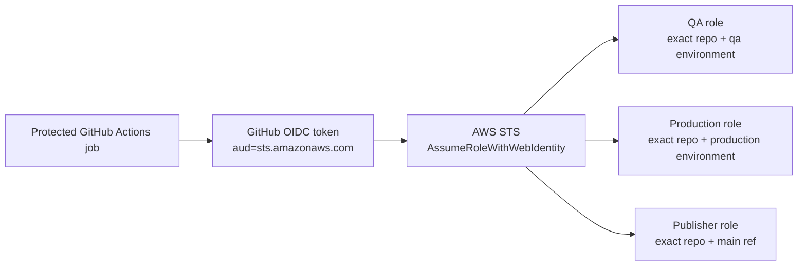
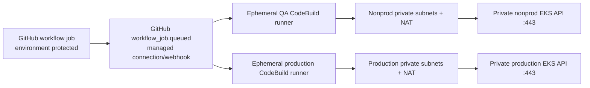
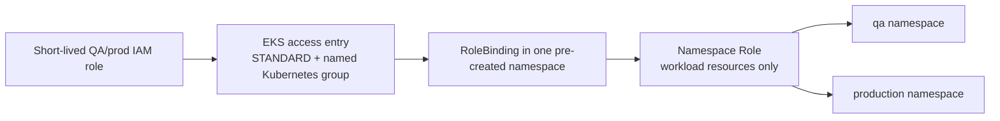

# CI identity and private EKS access

Milestone 5 defines three independent boundaries for future delivery: GitHub-to-AWS authentication, network reachability to the private EKS API, and Kubernetes authorisation. The Terraform and RBAC definitions are offline-validated contracts; they have not been applied. No live federation or runner was tested.

## 1. GitHub authentication to AWS

The application publisher, QA deployer, and production deployer use separate IAM roles. Each trusts the GitHub Actions OIDC provider at `https://token.actions.githubusercontent.com`, audience `sts.amazonaws.com`, and one exact subject for `Ibraheemolasupogit/devsecops-application-security-pipeline`. No wildcard owner or repository is accepted.

| Role | Exact subject | AWS permissions |
| --- | --- | --- |
| `graa-artifact-publisher` | `repo:Ibraheemolasupogit/devsecops-application-security-pipeline:ref:refs/heads/main` | ECR push/metadata operations on the single API repository; `ecr:GetAuthorizationToken` uses `Resource: *` because ECR requires it and is constrained to `aws:RequestedRegion` |
| nonprod QA deployer | `repo:Ibraheemolasupogit/devsecops-application-security-pipeline:environment:qa` | `eks:DescribeCluster` on `graa-nonprod` only |
| production deployer | `repo:Ibraheemolasupogit/devsecops-application-security-pipeline:environment:production` | `eks:DescribeCluster` on `graa-prod` only |

For environment-scoped subjects, branch restrictions belong to the protected GitHub Environment configuration. Production is restricted to `main` there and requires reviewer approval. GitHub OIDC eliminates AWS access-key secrets; it does not make an Environment protected by itself. Each AWS account must own exactly one provider for this issuer. If artifacts and EKS environment states share an account, create it in the first state and pass its output ARN to every later state; do not let two states both create it. With the recommended separate artifact/nonprod/prod accounts, each account may create its own account-local provider in its designated state.

## 2. Network path to private EKS

OIDC supplies credentials only; it does not route a GitHub-hosted runner into the VPC. The target execution path is a CodeBuild-hosted ephemeral GitHub Actions runner project in each target VPC and private subnet set. The existing EKS private API endpoint receives TCP 443 from that project's security group only. No public endpoint or inbound runner port is introduced.

Each project is configured for a single GitHub repository and filters queued jobs to its intended workflow name. GitHub Environment protections remain mandatory. The projects use a private subnet and the M3 NAT route for GitHub, AWS public APIs, and tool-download endpoints with changing addresses. Existing S3 gateway endpoints remain available; M5 adds no interface endpoints. Nonprod retains one NAT Gateway and its availability/capacity trade-off; production retains the M3 per-AZ NAT topology.

The CodeBuild service role is not a deployment role. It supports CodeBuild logging, VPC ENI lifecycle and use of the pre-authorized GitHub connection. Its ambient container credentials must not have EKS access, ECR push, `iam:PassRole`, or permission to assume the publisher/deployer roles. The GitHub Actions job requests its separate role through `id-token: write` and OIDC. AWS's CodeBuild runner is an ephemeral single-job runner; AWS documents that it terminates with the build. Direct OIDC token issuance inside this runner is not live-tested here; M6 must run a non-mutating, protected identity canary and fail closed if the expected OIDC token/claims are unavailable. No static-key fallback is allowed. See [CodeBuild runner prerequisites](../engineering/codebuild-github-runner.md).

CodeBuild runner registration/webhooks are separate from IAM federation. AWS requires a GitHub source connection for runner integration. A GitHub App-backed AWS CodeConnections connection is created and authorised once outside Terraform, then passed by ARN. Neither PATs nor App private keys are stored in Terraform, GitHub secrets, or this repository.

## 3. EKS authentication and Kubernetes authorisation

EKS access entries map the QA and production IAM deploy roles to `github:qa-deployer` and `github:production-deployer` groups. They receive no EKS-managed `AmazonEKSEditPolicy`: that policy can include namespace-local sensitive object access broader than CI requires. The corresponding Kubernetes `Role` and `RoleBinding` grant only the listed namespaced workload/configuration/governance resources and observation verbs. There is no access to Secret objects or their values, namespaces, cluster roles, nodes, CRDs, or cluster-wide mutations.

The platform creates namespaces and governance labels; workload overlays no longer create Namespace objects. The checked-in namespace and RBAC Kustomize roots are offline bootstrap contracts. A future platform/bootstrap identity applies namespace/RBAC foundations. Deployment roles cannot create namespaces or alter their own RBAC.

## Terraform ownership and outputs

`infrastructure/terraform/modules/github-oidc` creates or reuses an account-local provider; `github-actions-role` defines publisher/deployer policy boundaries; `codebuild-runner` defines the private project, service role, webhook, logs, and SG. `platform` composes one QA or production identity and runner with that environment's existing private VPC/EKS. The artifacts, nonprod, and prod compositions can own a provider when their ARN input is null or reuse an existing account-local provider ARN. Only one state may own creation for any AWS account; share its output across states in that account. Each distinct account requires its own provider. Root outputs expose provider ARNs, cluster name/region, project name and runner SG/service-role identifiers, never credentials.

Runner projects are conditional on a pre-existing CodeConnections ARN. With the example value `null`, the plan contains no runner project/security group and the EKS private endpoint remains closed to runners. Providing the ARN only configures IaC; it does not create the external connection or apply infrastructure. Terraform tests use mock providers only; never run an AWS-backed plan/apply as part of local validation.

Future workflows must route each job with `runs-on: codebuild-${{ vars.CODEBUILD_RUNNER_PROJECT }}-${{ github.run_id }}-${{ github.run_attempt }}` using that environment's project output. This label selects a one-job runner; it does not establish AWS identity. See [AWS's runner label contract](https://docs.aws.amazon.com/codebuild/latest/userguide/action-runner.html).

See [GitHub Environments](../engineering/github-environments.md), [CodeBuild runner](../engineering/codebuild-github-runner.md), and the [target delivery platform](target-devsecops-platform.md).

## Sources

- [AWS CodeBuild-hosted GitHub Actions runner tutorial](https://docs.aws.amazon.com/codebuild/latest/userguide/action-runner.html)
- [AWS CodeBuild runner questions and supported behavior](https://docs.aws.amazon.com/codebuild/latest/userguide/action-runner-questions.html)
- [AWS CodeBuild GitHub credential requirements](https://docs.aws.amazon.com/codebuild/latest/userguide/access-tokens-github.html)
- [AWS EKS access policies and access entries](https://docs.aws.amazon.com/eks/latest/userguide/access-policies.html)
- [AWS CodeBuild project Terraform resource](https://registry.terraform.io/providers/hashicorp/aws/latest/docs/resources/codebuild_project)
