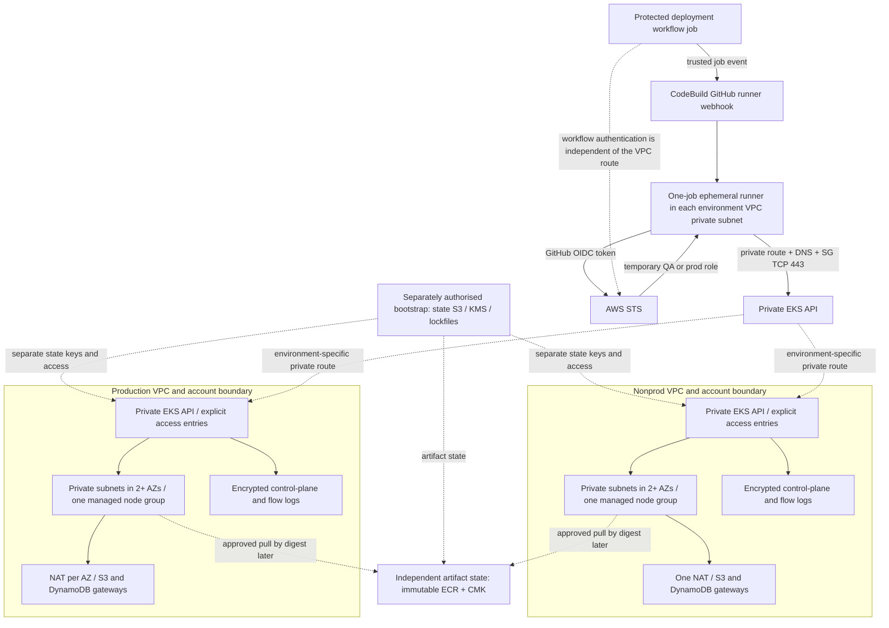

# EKS infrastructure foundation

Milestone 3 implements infrastructure as code only. Nothing has been applied or deployed. The existing `infrastructure/modules` and `infrastructure/environments/{dev,prod}` remain the non-deployed ECS/Fargate reference; the primary future runtime is `infrastructure/terraform`.

## Ownership and topology

| Composition | Ownership | Defaults |
| --- | --- | --- |
| `terraform/artifacts` | One environment-neutral private ECR repository and artifact CMK, independent state | Retain tagged images; no force deletion; repository prevent_destroy |
| `terraform/environments/nonprod` | Shared QA/test EKS cluster, its VPC, roles, key and operational logs | 10.20.0.0/16; one desired t3.medium; single NAT; 14-day logs; cluster deletion protection off |
| `terraform/environments/prod` | Separate production EKS cluster, VPC, roles, key and operational logs | 10.30.0.0/16; two desired t3.medium; NAT per selected AZ; 90-day logs; cluster deletion protection on |

There are exactly two cluster compositions. The artifact stack adds no cluster. Prefer separate nonprod/prod AWS accounts; the artifact repository can live in a designated delivery account. Account/region ownership remains a deployment prerequisite, not a discovered or invented account configuration. Region, two or three regional AZs, cost owner, administrator role ARNs, shared repository URL and approved add-on versions are explicit operator inputs. Optional API client security groups default to empty during bootstrap; M5 provisions the private executor path and supplies the authorised security group before cluster use. Example files contain placeholders and are deliberately not deployable.

## Module and version model

Reusable modules are networking, IAM, KMS, logging, EKS and ECR; `platform` composes the cluster foundation so environment wrappers cannot independently copy internal resource wiring. All new modules/compositions pin Terraform **1.16.5** and AWS provider **6.68.0**. Terraform 1.16.5 is the stable 1.16 patch selected for this review and supports native S3 lockfiles. AWS provider 6.68.0 is the signed stable 6.x release reviewed for this correction; its 6.67/6.68 release notes contain no changes to the EKS/VPC/IAM/KMS/ECR resources used here. The versions are exact pins and all compositions/tests are validated with these binaries. No Kubernetes, Helm, TLS or random provider is required. New root lockfiles record signed registry checksums including Linux CI and Darwin; three standalone module-test lockfiles retain the same portable provider checksums; root locks are authoritative for composition resolution. Existing ECS constraints and lockfiles remain unchanged. The two Terraform-installing workflows now select 1.16.5; their topology is unchanged.

Reuse is at the control/convention level: deny-default VPC security group, private workload placement, encrypted rotating keys/logs, immutable scanned ECR, tagging and separated service identities. ECS networking security groups, trust policies, three ECS-bound key policies and broad deployment permissions cannot be safely reused directly. The new ECR lifecycle deliberately replaces the reference's count-based expiry with untagged-only expiry; approved tagged rollback digests survive.

## Network and capacity

Each /16 VPC has two or three AZs. Each public subnet is /24; each private subnet is /20, with non-overlapping CIDR allocation for CNI IP capacity. Public subnet auto-assignment is off; only NAT gateways currently use public addressing. Load-balancer discovery role tags mark public/private subnets; no ALB is created. Per-AZ private routes lead to NAT, never directly to the internet gateway. S3 and DynamoDB gateway endpoints reduce NAT traffic without an interface-endpoint hourly fleet. ECR API/DKR, Logs, EKS Auth and STS currently use HTTPS through NAT. External IdP/scanner dependencies also need a verified egress path. A NAT-free design is rejected until complete connectivity is proven. Interface endpoints can be added after measured security/cost justification; they are not automatically cheaper.

Nonprod single NAT saves gateway hours but introduces an AZ failure dependency and cross-AZ processing/transfer. Production per-AZ NAT is the availability-oriented default; it is not necessary for a nonproduction portfolio environment. No publicly reachable workers or SSH keys/rules are configured. Worker ingress is node-self plus cluster security group TCP 443/10250. The API receives TCP443 only from workers and supplied controlled operator/runner security groups. AWS also owns the cluster security group's mandatory self rules; live inspection must confirm AWS reconciled rules. OIDC authenticates and authorises; it does not route network traffic. The primary M5 deployment executor is a CodeBuild-hosted GitHub Actions runner, with an ephemeral single-job runner project in each target environment VPC/private subnet. A trusted GitHub job event queues work on that runner. While the job executes, its GitHub OIDC token is exchanged at AWS STS for the environment-specific publisher/deploy role; the job then reaches the private EKS API over VPC routing/private DNS and TCP 443 from the runner security group. The CodeBuild service role is a separate minimal runner bootstrap identity and must not grant Kubernetes deployment permissions. A restricted GitHub App connection, managed through the CodeBuild integration, handles webhook/runner registration; it is distinct from OIDC. Restrict runner groups, workflow labels, branch/environment protection and webhook filters so untrusted pull-request jobs cannot land on deployment runners. GitHub-hosted runners cannot access this private endpoint directly.

One ON_DEMAND general managed node group uses AL2023 x86_64 and configurable compatible general-purpose instance types. t3.medium is a small initial choice, not proven application capacity. Nonprod min/desired/max is 1/1/2; prod is 2/2/3. These bounds do not install a cluster autoscaler and do not prove replica/AZ distribution or service HA. Nodes have encrypted 20-GiB gp3 roots, no application persistent volume, IMDSv2 required and hop limit 1 to reduce Pod node-role fallback. Node disk encryption uses the AWS EBS default key; account default encryption/key controls require deployment preflight. Future supported add-on components must use host networking or Pod Identity appropriately; test hop-limit compatibility rather than relaxing it silently.

## EKS, identity and access

Default Kubernetes is **1.36**, in EKS standard support through 2027-08-02 according to the [AWS lifecycle calendar](https://docs.aws.amazon.com/eks/latest/userguide/kubernetes-versions.html). This provides about four months more standard-support runway than 1.35 (which ends 2027-03-27). It remains configurable for a reviewed regional compatibility exception; 1.37 is intentionally outside this baseline. STANDARD upgrade support avoids opting into extended support; it can cause AWS upgrades when support ends, so controlled upgrade ownership is mandatory. Version/add-on compatibility is not established by offline validation. Exact essential add-on versions are mandatory inputs, not invented deployment pins.

AWS-managed essentials only: VPC CNI (network-policy feature enabled), kube-proxy, Pod Identity Agent before nodes, then CoreDNS after nodes. The CNI owns ENI permissions through a dedicated Pod Identity role bound to kube-system/aws-node, not the general node role. Self-managed bootstrap add-ons are disabled to avoid dual ownership. Bootstrap ordering avoids CoreDNS waiting for absent compute. Agent/CNI startup must be validated in an authorised environment. Enabling CNI network-policy capability creates no application policy and is not a claim of enforced isolation.

Separate IAM roles exist for EKS service, EC2 nodes and VPC CNI. AWS-managed AmazonEKSClusterPolicy, AmazonEKSWorkerNodePolicy, AmazonEC2ContainerRegistryPullOnly and AmazonEKS_CNI_Policy are service baselines; their broad describe/network operations are AWS-managed requirements, not general administrator grants. Managed policy updates must be reviewed before deployment. Node role has no application Secrets Manager/DynamoDB grants and no CNI attachment. CNI trust restricts session tags to this cluster, namespace and service account. Flow-log role grants only stream writes/description to its exact pre-created group. Bootstrap PassRole must target these specific roles.

EKS authentication mode is API, creator administrator permissions disabled. Explicit existing platform operator IAM roles receive STANDARD access entries and the EKS cluster-admin access policy (Kubernetes administration, not AWS AdministratorAccess). There is no legacy aws-auth manipulation. EKS manages managed-node-group node access. Require a recovery operator role and verify entry reconciliation before any deployment. Routine publisher/QA/prod CI roles are **not created** in M3: M5 grants publisher ECR operations; QA and production get separate STS roles, DescribeCluster and reviewed namespace access, never the platform administrator policy. Application namespace RBAC is M4/M5.

GitHub OIDC and EKS workload identity remain separate: the optional existing GitHub provider ARN is validated/exposed for later exact repo/audience/Environment trusts; no provider duplication or static keys are added. EKS issuer URL is exposed for a documented IRSA fallback if later compatibility requires it; no IAM OIDC provider is created because Pod Identity is the selected model. Application/ESO/controller service accounts, associations and AWS permissions remain later work. No AWS credentials are embedded in Pods (no Pods are authored here).

## Encryption and logs

One rotating 30-day-deletion-window cluster CMK serves EKS secret envelope encryption and two CloudWatch groups in that environment. Account-root key policy delegates use/administration through separately authorised IAM (standard AWS key-policy pattern); CloudWatch service use is additionally constrained to exact group encryption contexts and regional kms:ViaService. Bootstrap must have reviewed key administration/CreateGrant authority; no key administrator CI role is provisioned. ECR owns a separate artifact CMK, isolating its lifecycle from cluster teardown. State bootstrap owns a separate state key. Key rotation is enabled; disabling/scheduling deletion remains privileged operational work. Root delegation is not permission for every account identity to use the key.

All five control-plane streams (API, audit, authenticator, controllerManager, scheduler) and ALL VPC flow traffic are configured. CloudWatch groups are encrypted and pre-created before EKS. No application telemetry, dashboards, CloudTrail duplication, log agent or OpenTelemetry collector is installed. Existing reference CloudTrail remains illustrative; an account-owned organisation/management trail and required audit retention must be confirmed before real deployment. Cluster destroy removes operational log groups: export needed diagnostics first; durable release evidence must live outside the cluster state.

## Artifact and state boundaries

Create the artifact stack once through a future authorised deployment, then pass its URL to both cluster roots. No terraform_remote_state permission spanning environments is needed. After node-role creation, add explicit pull ARNs to the shared repository policy for cross-account use before any image pull. Same-account node AWS-managed pull permissions suffice. Cross-account ECR KMS behaviour/grants and registry policy must be tested before use; application Pods need no KMS decrypt grant just to pull images. No image is built/pushed or signing implemented. M6 captures SHA/digest/SBOM/findings and preserves tagged rollout/rollback images; future retention automation must protect active digests before expiring any tagged image.

Each root has a partial S3 backend and placeholder backend.hcl.example. Bootstrap is separate and unimplemented: private encrypted/versioned S3, public access blocked, TLS-only policy, KMS state encryption, S3 native lockfiles (`use_lockfile=true`), recovery/version retention and audited short-lived state access. Use distinct keys `eks/nonprod`, `eks/prod`, `eks/artifacts`; prefer separate prod bucket/account/roles, not just a key prefix. No DynamoDB locking table is needed with Terraform 1.16.5. Restrict ListBucket to needed prefixes, state GetObject/PutObject to exact state key, and lock GetObject/PutObject/DeleteObject to exact `.tflock` key. State delete permissions are unnecessary for ordinary operation. Scope KMS use to state encryption and approved principals; provision key administration independently. Protect backend configuration and Terraform state/plan values; never commit credentials or real local backend files. [S3 backend locking and permissions](https://developer.hashicorp.com/terraform/language/backend/s3).

Local `init -backend=false` and `validate` do not contact AWS; provider downloads contact the registry. Tests use mock_provider and command=plan, including rejection cases; they never run live AWS plans/applies. CLI outputs can suggest plan/apply generically; those suggestions are not executed. Offline validation cannot prove quotas, subnet IP sufficiency, AMI/add-on availability, SCPs, key/service grants or private network reachability.

## Consumption and remaining work

Outputs: cluster name/endpoint/public CA data, EKS OIDC issuer URL, VPC and public/private subnet IDs, cluster key and node-role ARNs, region, shared ECR URL and optional existing GitHub OIDC ARN. Artifact root additionally outputs repository ARN/key ARN. CA data is public trust material, not a secret. No kubeconfig, token or secret values are output.

M4 consumes the outputs as a configuration contract for Kustomize base/QA/prod overlays, namespace/service-account model, probes/resources/hardening and DynamoDB adapters with production identity configuration. M5 implements exact GitHub OIDC publisher/QA/prod roles and proves the separate CodeBuild-hosted ephemeral runner path into each private VPC/EKS API, along with namespace access and workload identity compatibility. Backend bootstrap, actual accounts/region/budget, CloudTrail ownership, DNS/TLS, ESO/ALB controllers, durable application data, ingress, observability and production promotion are unimplemented. No application runtime semantics change in M3.

Checkov exceptions are resource-local: attached-key policy wildcard resource/delegation semantics; 14/90-day operational retention; private-worker outbound bootstrap traffic; CKV_AWS_339's old version table. No global skips are introduced. The version exception must be retired on scanner upgrade, and every deployment requires a fresh supported-version check. See [cost controls](../engineering/eks-cost-controls.md) and [validation record](../engineering/eks-foundation-validation.md).
