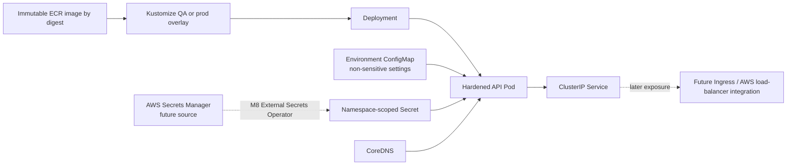

# Kubernetes workload model

Milestone 4 defines an offline, Kustomize-only workload model for the FastAPI API. It creates no AWS resources, makes no Terraform changes, contacts no EKS cluster and does not deploy. The M3 EKS foundation remains the future runtime boundary.

## Structure and environment mapping

```text
kubernetes/
  base/                         shared API, ServiceAccount, Service, PDB, NetworkPolicy
  overlays/qa/                  shared non-production cluster's qa namespace and sizing
    config/qa.env
    patches/
  overlays/prod/                dedicated production cluster's production namespace
    config/prod.env
    patches/
```

The base holds common workload behavior; overlays define namespace, non-sensitive environment configuration, quota/LimitRange and genuine capacity differences. QA is `qa` on the shared non-production EKS cluster. Production is `production` on its separate production cluster. The namespace labels enable Restricted Pod Security Admission and governance selectors. Namespaces do not provide the isolation of separate clusters; production's cluster/account/VPC boundary remains the stronger boundary.

## Artifact and deployment contract

The base image is an explicit, intentionally non-deployable ECR digest placeholder:

```text
<ACCOUNT>.dkr.ecr.<REGION>.amazonaws.com/genomic-research-access-api@sha256:<DIGEST>
```

There is no tag. M6 must replace the placeholder with the digest from its one build and immutable ECR publication. QA validates that exact digest; M10 promotes the same digest to production. Kustomize overlays do not select or rebuild environment-specific images. Manifests cannot be deployed until the placeholder is replaced and identity/secret prerequisites are satisfied.

The Deployment uses RollingUpdate (`maxUnavailable: 0`, `maxSurge: 1`), five retained revisions and a 30-second termination grace period. It exposes only TCP 8000 through a ClusterIP Service. LoadBalancer, NodePort, Ingress, ALB controller and external exposure are absent. A future Ingress may target the Service after a separately reviewed M8 edge design.

## Probes and application behavior

`/health` exists in the current FastAPI application and returns the service name, version and a constant healthy status. Startup, readiness and liveness probes all use that real route on port 8000. The route does not check persistence or other dependencies and is not a separate readiness/liveness contract. Until those semantics are designed, readiness only establishes that the API process can answer HTTP; it must not be presented as a data-store health check.

The application logs structured JSON to standard output/error, which the container runtime can collect. The API currently seeds a synthetic in-process dataset catalogue and stores access requests and audit events in memory. With two production Pods, those mutable records can diverge and disappear on restart. The production overlay is therefore a target workload shape, **not approved for deployment of state-changing API operations** until a shared durable persistence design is implemented and verified. M4 deliberately adds no persistence adapter.

## Pod hardening and identity

The runtime image already uses a non-root account; the Dockerfile now pins it to UID/GID 10001 for a stable Kubernetes identity. The Pod and container both require non-root UID/GID 10001, `RuntimeDefault` seccomp, no privilege escalation, no privileged mode, all Linux capabilities dropped, and a read-only root filesystem. `/tmp` is the only writable container path, backed by a 64 MiB bounded `emptyDir`. The identity-key mount is read-only. Host networking, PID and IPC namespaces are explicitly disabled; no hostPath is mounted.

The application ServiceAccount is dedicated and has token automount disabled both on the ServiceAccount and Pod. No Kubernetes RBAC or AWS IAM permission is attached. Kubernetes does not mount an API token into the workload. EKS Pod Identity/IRSA, AWS access, deployment roles and workload persistence identities remain later work.

## Configuration, secrets and network policy

Each overlay generates a hash-suffixed immutable ConfigMap for non-sensitive `GRAA_` runtime configuration. Documentation endpoints are disabled outside local development. Issuer values intentionally use the reserved `.invalid` domain until a real identity provider is selected; this keeps the model from accepting a placeholder as a production issuer.

The Deployment references, but does not define, a required `api-identity` Secret with key `jwt_public_key.pem`, mounted read-only at `/var/run/api-identity`. No Secret object or key material is committed. M8's planned delivery is AWS Secrets Manager → EKS workload identity → External Secrets Operator → namespace-scoped Kubernetes Secret → Pod. The eventual contents, rotation and access policy require review; no private JWT signing key belongs in this workload.

The NetworkPolicy selects only this API and allows ingress from a clearly reserved `ingress-system` namespace plus `app.kubernetes.io/component=workload-proxy`, and egress to CoreDNS on TCP/UDP 53. This is a future in-cluster proxy selector; the AWS Load Balancer Controller is not an application data-plane proxy, and no ingress controller is deployed here. The policy blocks other ingress and egress at the policy level. M3 has not enabled or tested an enforcing EKS network-policy dataplane, so the manifest alone does not guarantee enforcement. The application currently needs no AWS service egress. Standard NetworkPolicy cannot express all AWS-service/FQDN destinations; any later DynamoDB, Secrets Manager, telemetry or ALB path must be designed with the chosen CNI, VPC security groups/endpoints and verified egress controls.

## Governance, resources and disruption

QA runs one replica with 100m/128Mi requests and 500m/256Mi limits. Production models two replicas with 200m/256Mi requests and 1 CPU/512Mi limits per Pod. Both namespaces have explicit Pod, aggregate CPU/memory ResourceQuota and container LimitRange bounds. The production PDB allows one voluntary disruption while retaining at least one of two replicas; QA's one-replica PDB allows one disruption so a drain cannot become permanently blocked. Requests, limits, quotas and two replicas are starting portfolio values. Production sizing requires workload/load testing, durable persistence, headroom and review of node autoscaling and rollout capacity.

## M5–M8 consumers

- **M5** establishes protected GitHub-to-AWS federation and private execution connectivity; it does not need to change this workload contract.
- **M6** supplies the real immutable ECR image digest and supply-chain evidence to the overlay.
- **M7** activates the nonproduction platform and publishes a clean, eligible immutable digest; it does not deploy workloads.
- **M8** renders and deploys QA only after its image, auth settings, required Secret source, network-policy enforcement and runtime persistence implications are resolved. It validates rollout, Service reachability and the actual running digest.
- Later edge, secret synchronization, production approval/promotion and runtime assurance remain outside M4.

## Workload diagram


