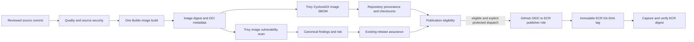
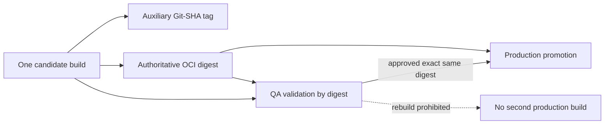

# Software supply-chain architecture

Milestone 6 implements the local and CI contract for one FastAPI image candidate. It connects source/security assurance, the built OCI image, the existing canonical findings and release-policy engine, and a guarded ECR publication operation. It does not provision AWS, publish during normal CI, or deploy a workload.

`make supply-chain-full` runs source-security prerequisites, builds one `linux/amd64` candidate, records the Buildx manifest digest, generates an image-derived CycloneDX SBOM, scans that same local image using Trivy, then regenerates AppSec, canonical findings and release evidence. The image ID is checked before and after scanning. The Git-SHA tag is a locator only; `sha256:…` is the artifact identity.

The local Trivy result is written to the existing `outputs/security/appsec/raw/trivy.json` source. Its findings continue through the existing normalization, deduplication, enrichment/risk and release-policy implementations. M6 adds no competing vulnerability record or release policy. A scan failure, missing digest, checksum mismatch, blocking Trivy finding, dirty source worktree, or blocked release decision cannot produce `eligible`. A conditional release decision yields `conditionally_eligible`; the workflow will not publish it until the existing required approval state is represented by an unconditional pass.

Build metadata and provenance use the Git commit timestamp, source commit, Dockerfile/dependency hashes, Buildx version, target architecture, image ID/digest, image SBOM/scan checksums, canonical Trivy finding IDs and release decision reference. `checksums.sha256` and a machine-readable manifest cover canonical outputs. These are repository-generated provenance records, not a signed statement and not a claim of SLSA compliance.

The ECR contract uses the M3 shared `genomic-research-access-api` repository, immutable tags, and the M5 artifact-publisher role. A trusted workflow may publish only by an explicit `workflow_dispatch` with mode `publish`, on `main`, with the repository publication flag enabled and an unconditional publication decision. GitHub-hosted PR and main workflows default to `verify`; no ECR interaction is attempted. The publisher logs in through AWS CLI ECR authorization after OIDC role assumption, pushes the existing local Git-SHA tag, asks ECR for its returned manifest digest, and accepts publication evidence only when that digest equals the Buildx digest. A mismatch blocks the evidence.

The workflow uses one job for quality prerequisites, one image build, SBOM, scan, findings/release evaluation, and optional publication. The local Docker image therefore remains the exact object between assurance and push; the job uploads only bounded evidence (14 days), not a Docker archive. No second build job is allowed to reconstruct a possibly different image.

The Dockerfile pins the official Python 3.11.17 slim Trixie multi-platform index to `sha256:e88e9763f943ec1834f992a4b51e0f24500486803e8bc534e5767af9ea65f6ce` in both stages. Buildx resolved this digest from Docker Hub on 2026-10-12. The M4 `appuser` UID/GID 10001 remains. The Dockerfile removes mutable `apt-get upgrade` steps, keeps pinned pip/setuptools/wheel tooling in the builder stage, retains the runtime multi-stage copy, health check and exec-form Uvicorn command, and adds OCI source/version/revision/created labels plus a SIGTERM stop signal. The current direct application dependencies are exact-pinned, but transitive Python requirements are not represented by a complete hash lock; byte-for-byte reproducibility is therefore not claimed. Refresh the base digest through an explicit image scan and reviewed change.

Signing and GitHub artifact attestations/Sigstore are deferred. M6 first establishes a checked, stable subject digest and a complete deterministic evidence chain. A later milestone should compare hosted provenance/attestation options, issuer trust, retention and verification at deployment/admission, then implement signing only with a consuming verification control.
